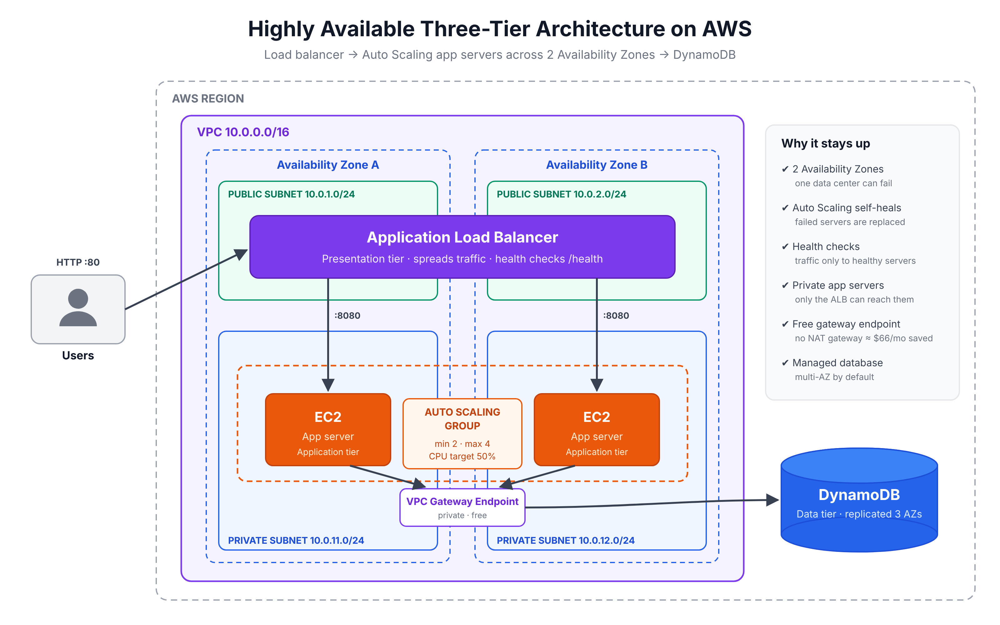

# Highly Available Three-Tier Architecture on AWS

A classic AWS web architecture, built to **keep running when a server or an entire data center fails** and to **grow automatically when traffic increases**.

> **In plain terms:** Visitors reach a load balancer, which spreads requests across several servers in two separate AWS data centers (Availability Zones). The servers store data in a managed database. If one server fails, the others keep serving. If traffic spikes, more servers start automatically.

---

## Architecture



| Tier | AWS Service | What It Does |
|---|---|---|
| **Presentation** | Application Load Balancer (ALB) | Single public entry point. Sends each request to a healthy server |
| **Application** | EC2 in an Auto Scaling group | Runs the app in **private** subnets across **2 Availability Zones** |
| **Data** | Amazon DynamoDB | Fully managed database, automatically replicated across 3 AZs |

---

## What This Project Covers

### Level 1: Fixing a Broken Three-Tier Setup
Most three-tier failures come from a few connection points between tiers. See the troubleshooting checklist in [`docs/troubleshooting.md`](docs/troubleshooting.md):

- Security groups blocking the load balancer from reaching the servers
- Target group health checks pointing at the wrong port or path
- EC2 instances missing IAM permissions to read and write DynamoDB
- Private subnets with no route to the database

### Level 2: Making It Highly Available and Scalable
See [`docs/high-availability.md`](docs/high-availability.md):

- Servers spread across **two Availability Zones**
- An **Auto Scaling group** that replaces failed servers automatically
- **Target tracking scaling** that adds servers when CPU passes 50%
- **ELB health checks**, so traffic only goes to servers that respond

---

## Design Decisions

| Decision | Why |
|---|---|
| App servers in **private subnets** | They can't be reached directly from the internet. Only the ALB can talk to them |
| Security group **chaining** (ALB → app) | The app port only accepts traffic from the load balancer's security group |
| **VPC gateway endpoints** instead of a NAT gateway | Private access to DynamoDB and S3 at no cost. A NAT gateway would add about $33 a month per AZ |
| **IMDSv2 required** | Blocks a common credential-theft technique on EC2 |
| **Least-privilege IAM** | The servers can only read and write one specific table |
| **DynamoDB on-demand** | No capacity planning. You pay per request |
| **Infrastructure as code** | The whole stack is one CloudFormation file ([`template.yaml`](template.yaml)) and can be rebuilt the same way every time |

---

## Well-Architected Framework

| Pillar | How This Design Addresses It |
|---|---|
| **Reliability** | Multi-AZ servers, Auto Scaling self-healing, health checks, and a multi-AZ database |
| **Performance Efficiency** | Scales out automatically based on CPU load |
| **Security** | Private subnets, security group chaining, least-privilege IAM, IMDSv2 |
| **Cost Optimization** | Gateway endpoints instead of NAT, on-demand DynamoDB, and scaling down when traffic is low |
| **Operational Excellence** | Everything defined in CloudFormation. Repeatable and version-controlled |
| **Sustainability** | Runs only the capacity that's needed, on small instances |

Full write-up: [`docs/well-architected.md`](docs/well-architected.md) · Cost breakdown: [`docs/cost-estimate.md`](docs/cost-estimate.md)

---

## Deploy It

**Prerequisites:** an AWS account and the AWS CLI configured.

```bash
aws cloudformation deploy \
  --template-file template.yaml \
  --stack-name three-tier-demo \
  --capabilities CAPABILITY_IAM

aws cloudformation describe-stacks --stack-name three-tier-demo \
  --query "Stacks[0].Outputs[?OutputKey=='AppUrl'].OutputValue" --output text
```

Wait 3 to 4 minutes for the servers to pass their health checks, then open the `AppUrl` in a browser.

### See the Load Balancing
Refresh the page a few times. The `served_by` and `availability_zone` values change as the ALB sends requests to different servers:

```json
{
  "message": "Hello from the three-tier app",
  "total_visits": 7,
  "served_by": "i-0abc123...",
  "availability_zone": "us-east-1a"
}
```

### Test the Self-Healing
1. In the EC2 console, **terminate** one of the app instances.
2. Keep refreshing. The site stays up because the other AZ keeps serving.
3. Within a few minutes, the Auto Scaling group launches a replacement.

### Clean Up
```bash
aws cloudformation delete-stack --stack-name three-tier-demo
```

---

## Tech Stack
`Amazon VPC` · `Application Load Balancer` · `EC2` · `Auto Scaling` · `DynamoDB` · `IAM` · `CloudFormation` · `Python`
