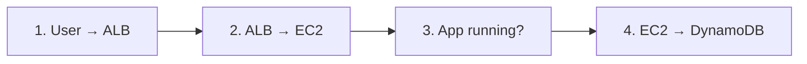

# Troubleshooting a Broken Three-Tier Architecture

When a three-tier app breaks, the problem is almost always at a **connection point between tiers**. Work through them in order, from the user inward.

## 1. User → Load Balancer
| Symptom | Check | Fix |
|---|---|---|
| Browser times out | ALB security group | Allow inbound **TCP 80** from `0.0.0.0/0` |
| Browser times out | ALB subnets | ALB must be **internet-facing** and in **public** subnets |
| Browser times out | Public route table | Needs a `0.0.0.0/0` route to the **internet gateway** |

## 2. Load Balancer → EC2
| Symptom | Check | Fix |
|---|---|---|
| **502 / 503** errors | Target group health | **Target groups → Targets** shows *unhealthy* |
| Targets unhealthy | App security group | Allow the app port (**8080**) **from the ALB security group** |
| Targets unhealthy | Target group port | Must match the port the app listens on (**8080**, not 80) |
| Targets unhealthy | Health check path | Must be a path that returns 200 (**`/health`**) |
| No targets at all | Auto Scaling group | Check that it's attached to the target group |

## 3. Is the App Running?
| Symptom | Check | Fix |
|---|---|---|
| Health checks fail | User data logs | Look at `/var/log/cloud-init-output.log` on the instance |
| Service crashed | systemd | Run `systemctl status app` and `journalctl -u app` |

## 4. EC2 → DynamoDB
| Symptom | Check | Fix |
|---|---|---|
| **AccessDenied** errors | Instance IAM role | The role needs `dynamodb:GetItem`, `PutItem` and `UpdateItem` on the table |
| No credentials | Instance profile | The instance must have an instance profile attached |
| Connection timeout | Private route table | Needs a **DynamoDB gateway endpoint** (or a NAT gateway) |
| ResourceNotFound | Table name and region | `TABLE_NAME` and the region must match the real table |

## Key Lesson
Security groups, route tables and IAM roles are the "glue" between tiers. Each tier can work perfectly on its own and still fail as a system if one link is missing.
